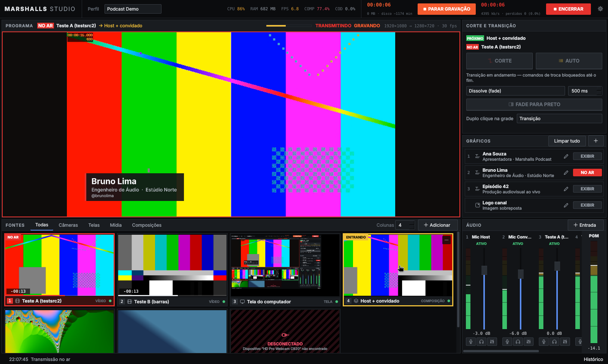

# MARSHALLS STUDIO

Software desktop de produção audiovisual ao vivo para podcasts, entrevistas, aulas e transmissões: grade permanente de fontes com miniaturas ao vivo, saída de programa real, cortes e transições, composições, identificações (lower thirds) animadas, mesa de áudio com processamento por canal, gravação multi-trilha e transmissão RTMP/RTMPS — tudo em uma única tela.



**Tecnologia:** C++17, Qt 6 Widgets e o motor **libobs** (OBS Studio) embarcado. Plataforma alvo: Windows 10/11 64 bits. Linux é usado como bancada de desenvolvimento e testes automatizados.

> **Licença:** o libobs é GPL-2.0-or-later; o produto distribuído deve seguir a GPL-2.0 (`LICENSE`, `docs/THIRD_PARTY.md`).

## Estado do projeto (v0.1.0)

Somente o que foi executado e medido está marcado como validado. Detalhes e números em [`docs/VALIDATION.md`](docs/VALIDATION.md).

| Área | Estado |
|---|---|
| Núcleo (modelo, persistência com migração/recuperação, máquina de estados do programa, atalhos, validação) | **Implementado e validado** — 30 testes unitários |
| Motor libobs: fontes, cenas solo e composições, barramento de programa, transições reais, fade para preto | **Validado** na bancada Linux (pixels da saída verificados) |
| Grade de fontes, monitor de programa, operação por clique/teclado | **Validado** manualmente na bancada (Xvfb) |
| Captura de tela | **Validado** (X11, pixel idêntico à referência); Windows implementado, não testado |
| Lower thirds/tarjas/títulos/logos na saída | **Validado** |
| Mesa de áudio: canais independentes, mute, fader, filtros, atraso por entrada | **Validado** com entradas virtuais (mix medido por análise espectral) |
| Gravação MKV multi-trilha, falta de disco, arquivo após falha abrupta | **Validado** (ffprobe/ffmpeg) |
| Transmissão RTMP, atraso intencional, estatísticas, chave fora dos logs | **Validado** contra servidor nginx-rtmp local |
| Desconexão/recuperação de dispositivos, UI responsiva sob carga | **Validado** (câmera ausente, microfone removido, CPU a 95%) |
| Build/instalador Windows (MSVC, NSIS, CI) | **Escrito, não executado** — próximo passo |
| Câmeras/microfones USB reais, GPU Intel, Quick Sync | **Pendente** — [`docs/HARDWARE_TEST_PLAN.md`](docs/HARDWARE_TEST_PLAN.md) |

Limitações e pendências: [`docs/LIMITATIONS.md`](docs/LIMITATIONS.md).

## Documentação
- [Compilação, execução e instalador](docs/BUILD.md)
- [Manual do operador](docs/OPERATION.md)
- [Arquitetura e decisões técnicas](docs/ARCHITECTURE.md)
- [Relatório de validação](docs/VALIDATION.md)
- [Plano de testes em hardware real](docs/HARDWARE_TEST_PLAN.md)
- [Limitações conhecidas](docs/LIMITATIONS.md)

## Início rápido

Windows (Developer PowerShell for VS 2022):
```powershell
powershell -ExecutionPolicy Bypass -File scripts\windows\build-obs.ps1     # libobs 30.2.3 (uma vez)
powershell -ExecutionPolicy Bypass -File scripts\windows\build.ps1         # app + testes + dist\
powershell -ExecutionPolicy Bypass -File scripts\windows\make-installer.ps1
```

Linux (Ubuntu 24.04):
```bash
sudo apt-get install -t noble-backports libobs-dev obs-studio
sudo apt-get install cmake ninja-build g++ qt6-base-dev qt6-base-dev-tools qt6-translations-l10n libgl1-mesa-dev
cmake -S . -B build -G Ninja && cmake --build build && ./build/src/app/MarshallsStudio
```

## Estrutura
```
src/core     modelo, persistência, estado do programa, atalhos, planejamento (sem libobs)
src/engine   fachada libobs, saídas, miniaturas, gráficos, plataforma, camada Studio
src/ui       mesa de direção, grade, mixer, diálogos, tema e ícones
src/app      ponto de entrada
tests/       unitários (core) e integração com o motor real (engine)
scripts/     build Windows, pacote, instalador; ambiente de testes Linux
installer/   script NSIS
docs/        documentação
```
