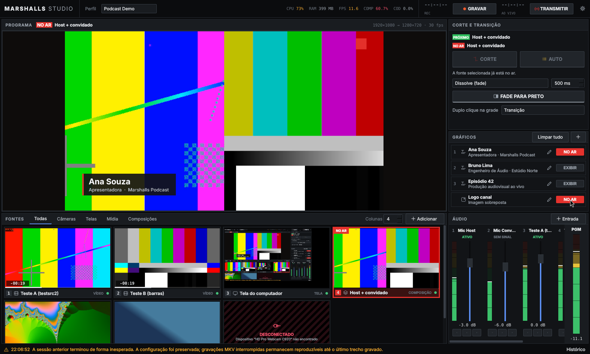
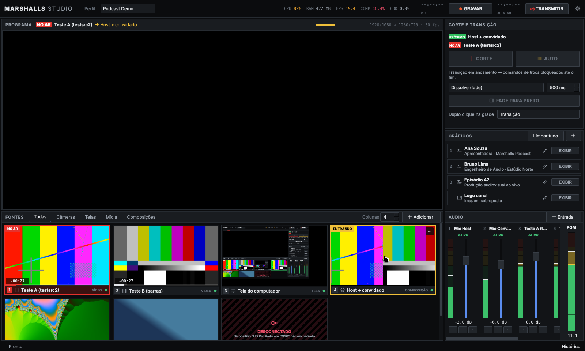
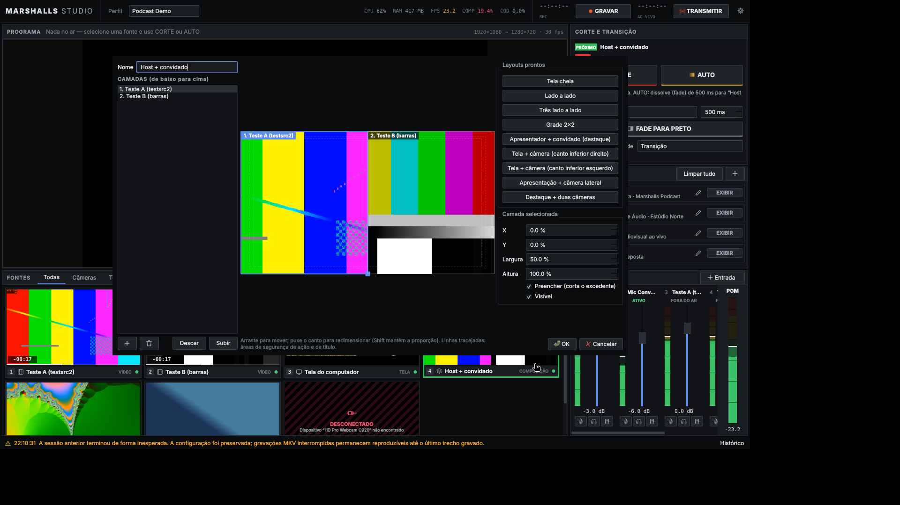
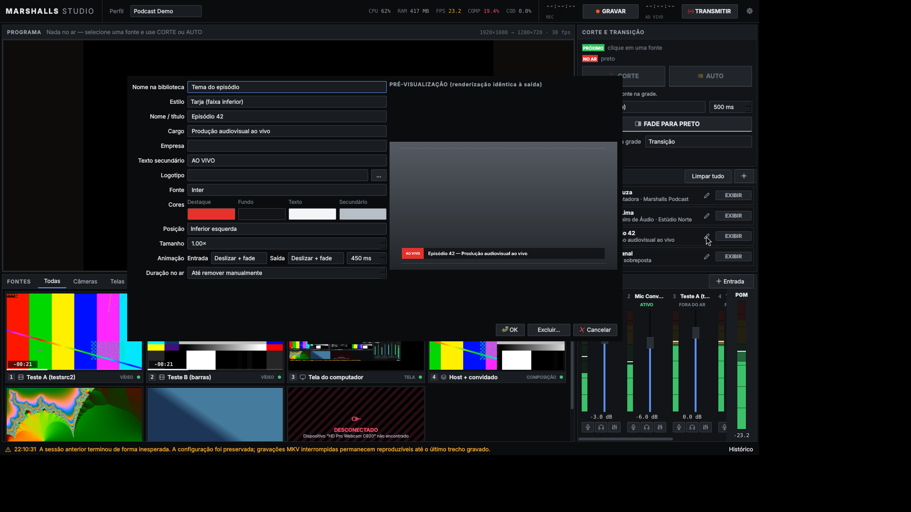

# Manual do operador

## A tela
| Área | Função |
|---|---|
| Barra superior | Perfil de produção, CPU/RAM/FPS, **COMP** (quadros perdidos na composição — GPU) e **COD** (quadros descartados pelo codificador — CPU), gravação e transmissão com cronômetro, bitrate e perdas |
| PROGRAMA | A saída real (o que é gravado/transmitido), com o nome do que está **NO AR**, a transição pendente e o estado das saídas. Moldura vermelha = gravando ou transmitindo |
| CORTE E TRANSIÇÃO | O que é **PRÓXIMO** (selecionado), o que está **NO AR**, os botões **CORTE** e **AUTO** com o efeito exato descrito abaixo deles, tipo e duração da transição, **FADE PARA PRETO** |
| GRÁFICOS | Identificações (lower thirds, tarjas, títulos) e logotipos preparados; um botão por item: EXIBIR / ENTRANDO / NO AR / SAINDO |
| FONTES | Grade permanente com miniaturas ao vivo de câmeras, telas, mídias e composições |
| ÁUDIO | Um canal por entrada + medidor **PGM** (o mix que sai) |
| Rodapé | Último aviso/erro; "Histórico" mostra os anteriores |

## Cores
- **Verde** — selecionado (próximo). **Vermelho** — no ar. **Amarelo** — entrando (transição em curso).
- Laranja — gravando. Âmbar — aviso. Rosa hachurado — falha/desconectado (sempre com texto).

## Fluxo básico
1. Clique em um cartão: ele fica verde (PRÓXIMO).
2. **CORTE** (Enter) troca na hora; **AUTO** (Espaço) faz a transição escolhida.
3. Duplo clique no cartão pode cortar ou transicionar direto (configurável no painel).
4. Durante uma transição ou FTB, novos comandos são recusados até o fim (evita estados ambíguos).
5. Trocar a fonte no ar nunca interrompe a gravação nem a transmissão.

Colocar uma fonte individual no ar não altera nenhuma composição. Para editar uma composição, clique com o botão direito → *Editar composição…*; se ela estiver no ar, as mudanças aparecem imediatamente (aviso em vermelho no editor).

## Fontes
*Adicionar* (grade) → Câmera, Tela inteira, Janela, Vídeo/vinheta, Imagem, Apresentação (sequência de imagens), Cor. *Entrada* (mesa de áudio) → Microfone, Áudio do computador.
- Cada dispositivo só pode ser usado por uma fonte (evita áudio duplicado e conflito de driver).
- *Propriedades…* → dispositivo, arquivo, **atraso de vídeo** (0–500 ms), uso do áudio da fonte, comportamento da mídia e *Configurações avançadas* (resolução, FPS, formato e demais opções do driver, aplicadas ao vivo).
- Vídeos/vinhetas: loop, reiniciar ao entrar no ar, ao terminar: manter último quadro / preto / **voltar automaticamente à fonte anterior**. Controles rápidos no cartão: reproduzir/pausar, reiniciar; tempo restante e barra de progresso.
- Cartão em erro mostra o motivo (ex.: "Dispositivo 'HD Pro Webcam C920' não encontrado") e oferece **Reconectar**.
- *Pausar miniatura* libera o dispositivo enquanto a fonte estiver fora do ar.
- Arraste cartões para reordenar; a posição define o número usado nos atalhos.

### Captura de tela e recursão
No Windows 10 2004+ o Marshalls Studio fica oculto das capturas de tela (Configurações → Interface), evitando o "espelho infinito". Em outros sistemas, capture outro monitor ou minimize o estúdio.

## Composições
Editor com render ao vivo, camadas (de baixo para cima), arrastar para mover, puxar o canto para redimensionar (Shift mantém proporção), áreas de segurança, campos numéricos e layouts prontos: tela cheia, lado a lado, três, grade 2×2, apresentador+convidado, tela+câmera (PiP), apresentação+câmera lateral, destaque+duas. "Preencher" corta o excedente em vez de deixar barras.

## Gráficos
Prepare antes do programa uma identificação por participante (nome, cargo, empresa, texto secundário, logotipo, cores, fonte, posição, tamanho, animações de entrada/saída, duração no ar ou "até remover"). A pré-visualização do editor é gerada pelo mesmo renderizador da saída.
Durante o programa: EXIBIR/NO AR por item, Alt+1…9 por posição, *Limpar tudo* (Alt+0). Gráficos permanecem no ar através de cortes e transições.

## Áudio
- Fader (−∞ a +10 dB), **mute** (vermelho), **monitoramento** (fone azul: só monitorar / monitorar e enviar), **FX** (dispositivo, sincronização, roteamento e processamento).
- Status do canal: ATIVO, SEM SINAL (silêncio > 1,5 s), MUDO, CLIP, FORA DO AR (áudio de mídia que não está no programa), SEM DADOS / DESCONECTADO (+ Reconectar).
- O medidor do canal mostra o sinal mesmo com mute (acinzentado) para o operador saber que o microfone está vivo.
- **PGM** mede exatamente o que é gravado e transmitido.
- Processamento por canal: ganho, supressão de ruído, gate, EQ de 3 bandas, compressor, limitador (aplicados ao vivo; Cancelar restaura).
- Avisos automáticos: mesmo dispositivo capturado duas vezes; monitoramento com captura de áudio do computador (risco de eco).

## Sincronização e atrasos — quatro coisas diferentes
| Ajuste | Onde | Efeito |
|---|---|---|
| Atraso de áudio por entrada | FX do canal → Sincronização | Atrasa o áudio daquela entrada em relação às demais fontes (ex.: microfone chegando antes da imagem da câmera) |
| Atraso de vídeo por fonte | Propriedades da fonte | Atrasa a imagem (ex.: áudio chegando depois da imagem) |
| Atraso intencional da transmissão | Configurações → Transmissão | Atrasa toda a transmissão (segurança/edição ao vivo). Não afeta a gravação local |
| Buffer do codificador / latência da rede e plataforma | — | Não controláveis pelo aplicativo |

Observação: em arquivos de mídia (e placas de captura com áudio embutido) o libobs sincroniza o vídeo ao relógio do próprio áudio da fonte; para mudar a relação entre os dois use o **atraso de vídeo**.

Como testar a sincronia: grave uma claquete (bater palmas diante da câmera) e verifique no arquivo; ajuste o atraso do microfone ou o de vídeo da câmera até o som coincidir com a imagem.

## Gravação
GRAVAR / PARAR GRAVAÇÃO (parar sempre pede confirmação). Formato MKV recomendado (sobrevive a quedas de energia; cópia MP4 automática opcional). Trilha 1 = programa; trilhas 2–6 = cada microfone isolado (para pós-produção). O estúdio verifica o espaço livre antes de iniciar e encerra a gravação com segurança se cair abaixo do mínimo configurado. A gravação continua mesmo que a transmissão caia.

## Transmissão
Configurações → Transmissão: destino (YouTube, Twitch, Facebook, personalizado), servidor, chave (guardada fora do perfil e nunca registrada em logs), codificador, bitrate, keyframe, atraso e reconexão. A validação ao vivo mostra erros (ex.: Facebook exige RTMPS) e avisos (bitrate acima do recomendado). Durante a transmissão: tempo, kb/s efetivo, quadros perdidos e %; "RECONECT." indica tentativa de reconexão. Encerrar pede confirmação.

## Atalhos padrão
| Tecla | Ação |
|---|---|
| Enter | Corte para a fonte selecionada |
| Espaço | Transição automática |
| B | Fade para preto / voltar |
| 1…9 | Selecionar fonte 1…9 da grade |
| Ctrl+1…9 | Colocar fonte 1…9 no ar (corte) |
| Alt+1…9 | Exibir/remover gráfico 1…9 |
| Alt+0 | Remover todos os gráficos |
| F1…F8 | Mute do canal de áudio 1…8 |
| P / Shift+P | Reproduzir-pausar / reiniciar a mídia no ar |
| Ctrl+R | Iniciar gravação (encerrar pede confirmação) |
| Ctrl+Shift+L | Iniciar transmissão (encerrar pede confirmação) |

Editáveis em Configurações → Atalhos, com detecção de conflitos (atalhos em conflito ficam inativos). Combinações do sistema (Alt+F4, Ctrl+Q, Alt+Tab…) são bloqueadas. Atalhos não disparam enquanto se digita em um campo ou com diálogos abertos.

## Perfis
O seletor "Perfil" guarda conjuntos completos (fontes, composições, gráficos, áudio, saídas, atalhos, layout da tela). Trocar de perfil exige gravação e transmissão encerradas.

## Problemas comuns
| Sintoma | Causa provável / ação |
|---|---|
| COMP alto (vermelho) | GPU sobrecarregada: reduza canvas/FPS, miniaturas (Interface) ou fontes de alta resolução |
| COD alto | Codificador sobrecarregado: use Quick Sync/NVENC, reduza resolução de saída/FPS ou preset |
| Cartão "Sem sinal" | Dispositivo aberto mas sem quadros: verifique cabo/driver; "Reconectar" |
| Canal "SEM DADOS"/"DESCONECTADO" | Microfone desconectado: reconecte o USB e clique "Reconectar" |
| "Transmissão interrompida" | Mensagem traz o motivo (chave recusada, rede, servidor). A gravação local continua |
| Aviso de sessão anterior | O aplicativo foi encerrado inesperadamente; a configuração foi preservada e MKVs interrompidos são reproduzíveis |

Logs: menu da engrenagem → *Abrir pasta de logs*. Diagnóstico completo (versões, codificadores, estado das fontes): Configurações → Diagnóstico → *Copiar relatório*.
